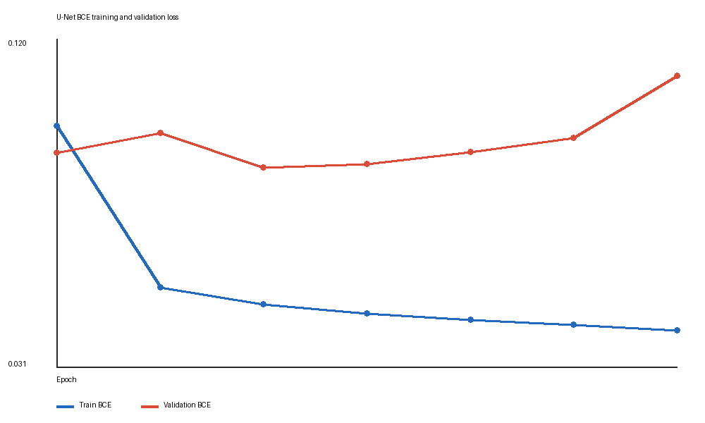
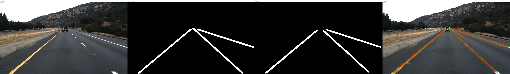
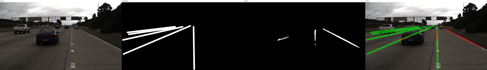

# Lane Segmentation Challenge 재현 프로젝트

## 프로젝트 배경

학부 자동차 인공지능 수업에서 딥러닝과 차선 분할을 처음 경험했고, Coursera 학습 이후 Kaggle `Lane Segmentation Challenge`에 참가했다. 당시 기록한 Public Score `0.69166`은 과거 대회 결과이며, 이번 구현의 성능으로 간주하지 않는다.

이번 프로젝트는 같은 대회의 실제 학습 이미지와 차선 mask로 PyTorch U-Net을 재학습하고, 고정된 주행 그룹 validation과 Kaggle 평가 결과를 함께 기록한다. validation metric과 Kaggle Public/Private Score는 서로 다른 평가 결과로 구분한다.

## 대회와 데이터

- 대회: [Lane Segmentation Challenge](https://www.kaggle.com/competitions/lanesegmentationchallenge)
- 사용 파일: `data/lanesegmentationchallenge.zip` (로컬 전용, Git 제외)
- ZIP에는 train RGB 이미지 3,626장, `lane-masks` 3,626장, test 이미지 2,782장, `sample_submission.csv`가 들어 있다.
- 원본 이미지와 mask는 1280×720 JPEG다. Mask가 JPEG로 압축되어 픽셀값이 완전한 0/255가 아니므로, grayscale 값 `>127`을 차선으로 이진화한다. 전처리 시 전체 mask 픽셀값과 foreground 비율을 `data/processed/dataset_report.json`에 기록한다.
- 파일명에서 날짜 그룹을 추출한다. `0313-1`과 `0313-2`는 모두 `0313` 그룹으로 묶어 동일 날짜의 인접 시퀀스가 train/validation에 나뉘지 않게 한다. 실제 분할은 seed 42로 `0601` 410장을 validation으로 선택하고, 나머지 3,216장을 train에 둔다. 전체 mask에서 grayscale 값은 0-8 및 247-255이고, `>127` 기준 lane foreground는 4.28%다. 그룹 수가 적어 validation은 주행 전체 분포를 대표하지 않을 수 있다.
- Kaggle 설명의 평가는 이미지별 Dice 평균이다. 코드에서는 이를 `mean_image_dice`로 기록하고 pixel-global Dice/IoU와 구분한다.

Kaggle 대회는 2025-06-22 종료되었다. 사용자가 제공한 Kaggle Submissions 화면에서 `submission_unet_bce.csv`가 `Complete (after deadline)` 상태로 평가된 것을 확인했다. 2026-11-16 화면의 새 점수는 Public `0.75676`, Private `0.75864`다. 과거 제출 `0.69166` Public / `0.69043` Private 대비 각각 `+0.06510`, `+0.06821`이다. 이는 같은 대회 leaderboard 점수의 제출 간 비교이며 validation 지표와 혼동하지 않는다. 과거 CSV는 test 정답을 포함하지 않으므로 점수 재계산에 사용하지 않는다.

## 모델과 실험

- 입력 RGB, 기본 크기 288×512
- U-Net encoder 채널 `32-64-128-256-512`, skip connection, 1채널 logits 출력
- Loss `BCEWithLogitsLoss`, optimizer AdamW
- 학습 이미지 bilinear resize, mask nearest-neighbor resize 및 `>127` 이진화
- 날짜 그룹 holdout, 고정 seed, validation loss 기준 best checkpoint 및 early stopping
- 지표: validation BCE, 이미지별 평균 Dice, pixel Dice/IoU, precision, recall
- 제출 생성은 sample submission의 순서와 헤더를 보존한다. 과거 제출 형식인 `filename,rle`도 지원한다.

과거 제출 CSV를 test 이미지에 overlay해 확인한 RLE 해석은 C-order, 1-based이며 새 제출도 Kaggle 평가에서 완료되었다. 제출 완료와 점수는 사용자가 공유한 Kaggle 화면으로 확인했으며 API를 통한 독립 확인은 수행하지 않았다.

## 환경 설정

Windows PowerShell에서 프로젝트 폴더에서 실행한다. 기존 `.venv`와 CUDA PyTorch 환경을 유지한다.

```powershell
python -m venv .venv
.\.venv\Scripts\Activate.ps1
python -m pip install --upgrade pip
python -m pip install -r requirements.txt
python -m pip install -e .
```

현재 개발 환경은 Python 3.12, PyTorch 2.11.0+cu128, RTX 4060 Laptop GPU다. 설치 후 확인:

```powershell
python -c "import torch; print(torch.__version__, torch.cuda.is_available(), torch.version.cuda); print(torch.cuda.get_device_name(0) if torch.cuda.is_available() else 'CPU')"
```

## 데이터 준비 및 학습

ZIP을 `data/raw/`에 안전하게 풀고, 이미지-mask 이름·크기·열림 여부, mask 값 분포, sequence 그룹 분할을 검사한다. Train/validation manifest와 8장씩의 실제 데이터 smoke manifest를 생성한다.

```powershell
python -m lane_segmentation.prepare_data `
  --archive data/lanesegmentationchallenge.zip `
  --data-root data/raw/lanesegmentationchallenge `
  --processed-root data/processed `
  --seed 42
```

소규모 실제 데이터 GPU 학습, checkpoint 저장 확인:

```powershell
python -m lane_segmentation.train --config configs/smoke.yaml
```

Baseline 전체 train split 학습, validation 평가 및 시각화 생성:

```powershell
python -m lane_segmentation.train --config configs/baseline.yaml
python -m lane_segmentation.evaluate `
  --config configs/baseline.yaml `
  --checkpoint experiments/kaggle-unet-bce/best.pt `
  --output-dir results/predictions
```

대회 sample submission의 test 행 순서를 사용해 Kaggle validator가 요구하는 `filename,rle` CSV를 생성한다.

```powershell
python -m lane_segmentation.submission `
  --config configs/baseline.yaml `
  --checkpoint experiments/kaggle-unet-bce/best.pt `
  --sample-submission data/raw/lanesegmentationchallenge/sample_submission.csv `
  --test-root data/raw/lanesegmentationchallenge/test/test/frames `
  --output data/submissions/submission_unet_bce.csv `
  --threshold 0.35 `
  --output-format filename-rle `
  --rle-order C `
  --index-base 1
```

대회 제공 template 열은 `image_id,encoded_pixels`이지만 실제 Kaggle validator는 `filename,rle`을 요구했다. 따라서 `--output-format filename-rle`로 요구된 열 이름을 출력한다. 생성 CSV의 행 수 2,782, 열 이름, 행 순서, RLE 범위를 검사한 뒤 Kaggle에 업로드했고 평가가 완료되었다. 기존 `data/submissions/submission.csv`는 덮어쓰지 않는다. 데이터, checkpoint, 인증 파일, 생성 CSV는 Git에 올리지 않는다.

## 검증 및 결과 기록

```powershell
python -m pytest -q
```

전체 BCE baseline은 7 epoch에서 early stopping 되었으며, 최소 validation BCE checkpoint는 epoch 3이다. Checkpoint의 validation BCE는 0.08538, threshold 0.5에서 이미지별 평균 Dice 0.68558 / pixel Dice 0.68366 / IoU 0.51936을 기록했다. 같은 validation group에서 threshold sweep으로 0.35를 선택하면 이미지별 평균 Dice 0.71535 / pixel Dice 0.71309 / IoU 0.55411이다. Threshold 선택과 보고에 같은 validation을 사용했으므로 선택 threshold 성능은 독립 test score가 아니다. 학습 epoch 6의 mean image Dice 0.69826은 별도 로그 수치이며, checkpoint가 epoch 3인 사실과 구분한다.

Loss curve는 [kaggle-unet-bce-loss.png](./results/figures/kaggle-unet-bce-loss.png), best/failure validation 시각화와 JSON/CSV 평가 결과는 [kaggle-unet-bce/](./results/predictions/kaggle-unet-bce/)에 저장한다. 실험 수치와 산출물 목록은 [experiments/README.md](./experiments/README.md)에 기록한다.

### Kaggle 대회 평가 결과

| 제출 기록 | 상태 | Public Score | Private Score |
|---|---|---:|---:|
| 과거 제출 (`submission.csv`) | Complete | 0.69166 | 0.69043 |
| U-Net BCE (`submission_unet_bce.csv`) | Complete (after deadline) | **0.75676** | **0.75864** |
| 제출 간 차이 | 같은 대회 leaderboard | **+0.06510** | **+0.06821** |

새 점수는 사용자가 공유한 Kaggle Submissions 화면에서 확인했다. 마감 후 평가된 결과이므로 대회 종료 시점의 공식 순위나 수상 기록으로 표현하지 않는다. Kaggle 점수는 test 데이터 평가이고, 고정 group validation의 Dice와 직접 비교하지 않는다.







Baseline 이후 BCE/Dice, augmentation, TTA는 같은 split에서 검증할 후속 실험이며, 아직 수행하지 않은 결과를 성능 개선으로 기술하지 않는다.

## 프로젝트 구조

```text
configs/                 학습 및 실제 데이터 smoke 설정
data/                    데이터 안내 (원본 및 처리물은 Git 제외)
src/lane_segmentation/   Dataset, U-Net, 학습, 평가, 제출 생성
tests/                   데이터·모델·지표·제출 형식 테스트
experiments/             실험 기록 및 checkpoint (checkpoint Git 제외)
results/                 실제 평가 시각화 (결과물만 관리)
```

## 한계와 다음 단계

- 데이터셋이 날짜 그룹 4개뿐이므로 한 그룹 holdout validation의 표본과 조건 다양성이 제한적이다.
- 과거 제출 CSV는 test 정답을 포함하지 않으며, 과거 Public Score 자체를 재현하거나 그 CSV만으로 개선 점수를 계산할 수 없다.
- 새 제출은 마감 후 Kaggle 화면에서 완료와 점수 표시를 확인했지만, leaderboard 최종 선택/순위 반영 여부는 주장하지 않는다.
- 후속 작업은 BCE/Dice, augmentation, TTA를 동일한 validation split에서 비교하고, 가능하면 여러 주행 그룹을 holdout해 평가하는 것이다.
- 실제 자율주행 적용 전에는 더 다양한 주행 조건, 장면 단위 검증, temporal consistency, 추론 지연 측정, 차량용 배포 검증이 필요하다.
