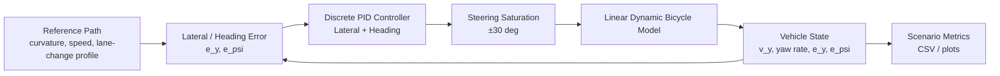
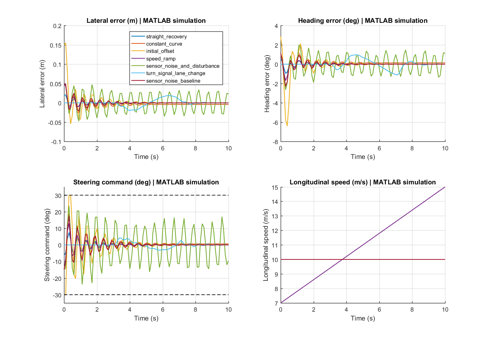
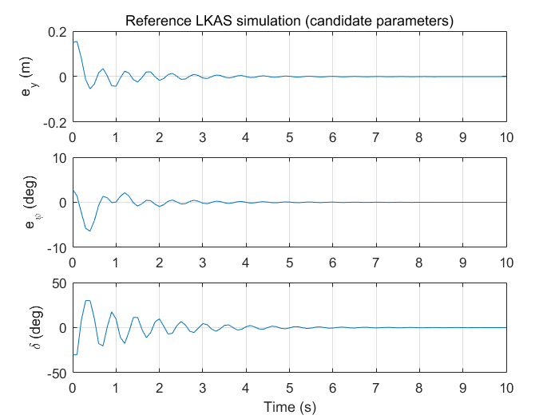
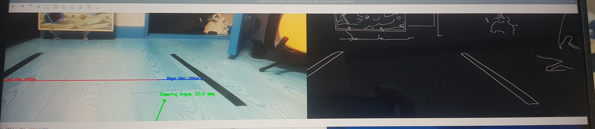
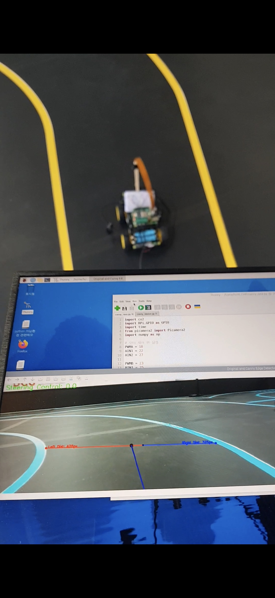
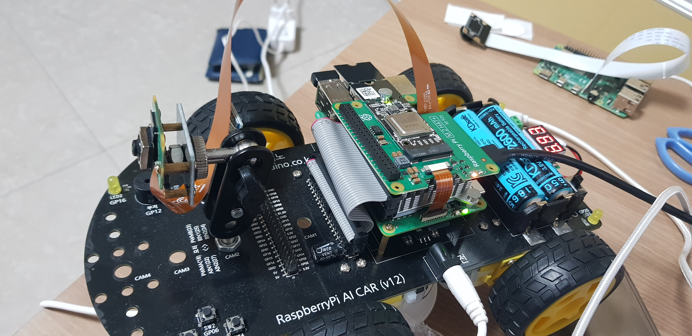

# Lane Keeping Assist System (LKAS)

### Vehicle Dynamics Modeling & PID Steering Control

**MATLAB 기반 차량 횡방향 동역학 모델링 및 차선 유지 조향 제어 시스템**

본 프로젝트는 MATLAB 환경에서 선형 Dynamic Bicycle Model을 기반으로 차량의 횡방향 거동을 모델링하고, Lateral/Heading Error를 이용한 이산 PID 조향 제어기를 구현한 프로젝트입니다. 직선, 곡선, 초기 위치 오차, 속도 변화, 외란 등 7개 주행 시나리오를 구성하여 차선 추종 성능과 조향 응답을 정량적으로 분석했습니다.

> **이번 MATLAB LKAS 구현 범위:** 동역학 모델, PID 제어, 포화 처리, 7개 시나리오 및 결과 데이터는 MATLAB 함수와 실행 산출물로 검증했습니다. 이 MATLAB 모델에는 Simulink/Stateflow, 카메라 입력 및 미니카 실시간 연동이 포함되지 않습니다. 별도 미니카 프로젝트는 아래 섹션에 기록합니다.

## 01. Project Overview

### 개발 배경 및 목표

학부 자동차 제어 학습에서 다룬 LKA, Bicycle Model, 횡방향/Yaw 제어 개념을 바탕으로 차량 거동과 조향 응답을 독립적으로 분석할 수 있는 MATLAB 시뮬레이션을 구성했습니다. 설계 수식, 구현 코드, 시험 조건과 정량 결과가 서로 추적되도록 정리하는 것이 목표입니다.

### 기술 스택

`MATLAB R2016a` · Linear Dynamic Bicycle Model · Discrete PID · RK4 · CSV · MATLAB Plot · Automated Assertions

### 주요 기능

- 선형 타이어 코너링 강성을 이용한 차량 횡방향·요 동역학 모델
- Lateral/Heading Error 기반의 이산 P/I/D 제어 루프
- 조향 명령 포화 및 Conditional Integration Anti-Windup
- 직선·곡률·초기 오차·속도 ramp·노이즈/외란·차선 변경 등 7개 시나리오
- RMS/최대 오차, yaw response, steering response 및 CSV/그래프 산출
- 시나리오 자동 검사와 저장 결과 간 수치 일관성 검증

## 02. System Architecture







오차 피드백은 카메라가 아니라 차량 모델의 상태에서 계산됩니다. Lane-change case는 기준 경로와 제어 상태를 정의한 가상 시나리오입니다.

## 03. Vehicle Dynamics Modeling

구현 모델은 **Kinematic Bicycle Model이 아닌 선형 Dynamic Bicycle Model**입니다. 전·후륜 선형 타이어 횡력을 통해 횡속도와 yaw rate의 동역학을 계산합니다.

### 상태와 좌표계

| 변수 | 단위 | 정의 및 부호 |
|---|---|---|
| `v_y` | m/s | 차량 차체 좌표계의 횡속도 |
| `r` | rad/s | 반시계 방향 양수 yaw rate |
| `e_y` | m | 기준 경로 왼쪽 방향 양수 횡방향 오차 |
| `e_psi` | rad | 차량 heading − 기준 경로 heading |
| `delta` | rad | 좌회전 양수로 가정한 전륜 road-wheel 조향각 |
| `v_x` | m/s | 양수 종방향 속도 |

### 동역학 방정식

```text
alpha_f = delta - (v_y + a r) / v_x
alpha_r =             -(v_y - b r) / v_x
F_yf    = C_f alpha_f
F_yr    = C_r alpha_r

v_y_dot   = (F_yf + F_yr + F_disturbance) / m - v_x r
r_dot     = (a F_yf - b F_yr) / I_z
e_y_dot   = v_y + v_x e_psi
e_psi_dot = r - v_x kappa
```

`m`은 질량, `I_z`는 yaw 관성, `a/b`는 CG에서 전/후륜 축까지의 거리, `C_f/C_r`는 전/후륜 코너링 강성, `kappa`는 기준 경로 곡률입니다. 차량 동역학은 제어 주기 사이를 1 ms 고정 간격 RK4로 적분합니다.

| 파라미터 | 값 | 단위 | 모델 적용 |
|---|---:|---|---|
| Vehicle mass `m` | 2045 | kg | 후보 차량 파라미터 |
| Yaw inertia `I_z` | 5428 | kg·m² | 후보 차량 파라미터 |
| CG to front/rear axle `a/b` | 1.488 / 1.712 | m | wheelbase 합 3.2 m |
| Front/Rear cornering stiffness `C_f/C_r` | 38925 / 38255 | N/rad 가정 | 차축 합산값으로 해석 |
| Controller sample time `T_s` | 0.1 | s | 제어 갱신 간격 |
| Maximum steering angle | ±30 | deg | 전륜 road-wheel angle 가정 |

코너링 강성의 축/타이어 기준과 기록된 0.1 s, 30° 파라미터의 실제 의미는 [설계 보고서](docs/design-report.md)에 명시한 모델링 가정으로 다룹니다. 선형 타이어·소슬립·평탄한 도로를 가정하며 타이어 포화와 액추에이터 동특성은 포함하지 않습니다.

## 04. PID Steering Controller

Lateral Error 및 Heading Error에 각각 이산 PID를 적용한 뒤 두 출력을 합산하여 조향 명령을 생성합니다. 코드에서 P/I/D 세 항을 모두 계산합니다.

```text
u_y   = Kp_y e_y + Ki_y ∫e_y dt + Kd_y d(e_y)/dt
u_psi = Kp_psi e_psi + Ki_psi ∫e_psi dt + Kd_psi d(e_psi)/dt
delta = clip(-(u_y + u_psi), -delta_max, +delta_max)
delta_max = 30 deg
```

| 제어 루프 | `Kp` | `Ki` | `Kd` |
|---|---:|---:|---:|
| Lateral Error PID | 4.0 | 0.1 | 0.2 |
| Heading Error PID | 3.0 | 0.1 | 0.3 |

각 제어 루프는 `T_s = 0.1 s`로 갱신하며, 미분은 측정 오차의 후진 차분입니다. 조향 출력 포화를 더 키우는 방향으로 두 적분항이 변할 때 해당 주기의 적분 갱신을 보류하는 Conditional Integration 로직을 적용했습니다. 게인의 단위와 실제 전륜각으로 변환되는 계수는 확인된 기록이 없으므로 제어 응답은 구현 모델 내 비교로 해석합니다.

## 05. Simulation Scenarios

7개 시나리오 모두 10초·101 제어 샘플을 사용합니다. 아래 성능은 MATLAB 모델에서 생성된 값이며 물리 차량의 측정값이 아닙니다.

| 시나리오 | 입력 조건 | 시험 목적 | RMS `e_y` (m) | 주요 결과 |
|---|---|---|---:|---|
| `straight_recovery` | 10 m/s; `e_y=+0.02 m`, `e_psi=+0.01 rad` | 작은 직선 오차 복원 | 0.003795 | 최대 `|e_y|` 0.020486 m; 정착 0.2 s |
| `constant_curve` | 10 m/s; `kappa=0.003 1/m`; 초기 `+0.05 m/+0.02 rad` | 일정 곡률 추종 | 0.009925 | 최대 `|e_y|` 0.050000 m; 최대 `|delta|` 18.814° |
| `initial_offset` | 10 m/s; `e_y=+0.15 m`, `e_psi=+0.05 rad` | 큰 초기 오차 복구/포화 | 0.025533 | 최대 `|e_y|` 0.154836 m; 포화 4/101; 정착 1.9 s |
| `speed_ramp` | 속도 7→15 m/s/10 s; 초기 `+0.05 m/+0.02 rad` | 속도 변화 응답 | 0.007267 | 최대 `|delta|` 14.937°; 정착 0.2 s |
| `sensor_noise_and_disturbance` | 초기 `+0.05 m/+0.02 rad`; 측정 노이즈 `0.01 m/0.003 rad`, 외란 300 N | 측정 오차/횡외란 영향 | 0.025009 | 최대 `|r|` 0.436017 rad/s; 2 cm 정착 미달 |
| `turn_signal_lane_change` | 10 m/s; 3.5 m 차로 간 reference 이동, turn signal | 차선 변경 reference 추종/state 출력 | 0.008401 | 최대 `|e_y|` 0.019469 m; 포화 0 |
| `sensor_noise_baseline` | noisy case와 같은 초기조건; 노이즈/외란 제거 | baseline 비교 | 0.008993 | 최대 `|e_y|` 0.050000 m; 정착 1.0 s |

상세 시나리오 조건은 [Simulation Scenarios](simulation/scenarios.md), 전체 지표는 [scenario_metrics.csv](results/simulation/scenario_metrics.csv)를 참조하세요.

## 06. Experimental Results

**MATLAB R2016a 시뮬레이션에서 생성한 수치 결과**입니다. 각 값은 CSV와 자동 검사로 확인했습니다.

| 분석 조건 | 정량 결과 | 해석 |
|---|---|---|
| 직선 초기 오차 복원 | RMS Lateral Error **0.003795 m**; max absolute **0.020486 m** | 작은 초기 오차를 기준 경로 주변으로 줄임 |
| 큰 초기 위치 오차 | max absolute Lateral Error **0.154836 m**; 최대 조향 **30.000°** | 조향 포화가 4/101 samples 발생 |
| 일정 곡률 | RMS Lateral Error **0.009925 m**; max steering **18.814°** | `0.003 1/m` curvature 입력 추종 |
| 속도 ramp | RMS Lateral Error **0.007267 m**; yaw-rate 최대 **0.256826 rad/s** | 7→15 m/s 단일 ramp case |
| 노이즈·외란 | RMS Lateral Error **0.025009 m** | noisy/disturbed case에서 0.02 m 정착 기준을 만족하지 못함 |
| 노이즈 없는 비교 | RMS Lateral Error **0.008993 m** | noisy/disturbed case와 초기조건이 동일한 비교 기준 |
| 차선 변경 reference | max absolute tracking error **0.019469 m** | 이상적인 모델 내부 reference 추종 결과 |

시나리오 비교의 조향 응답은 전륜각 가정 기준 ±30° 제한을 표시합니다. 노이즈와 횡방향 외란을 동시에 적용했으므로 두 영향은 분리되지 않았습니다. 모든 결과는 모델 기반 수치이며 실차 검증 성능으로 해석하지 않습니다.

- [Scenario metrics CSV](results/simulation/scenario_metrics.csv)
- [Full scenario time-series CSV](results/simulation/scenario_timeseries.csv)
- [Large-offset reference time-series CSV](results/simulation/reference_simulation.csv)
- [Scenario comparison graph](results/simulation/scenario_comparison.png)
- [Large-offset tracking/steering graph](results/simulation/reference_simulation.png)

## 07. Engineering Analysis

### PID Gain 변화

`Kp`는 현재 오차에 대한 조향 민감도, `Ki`는 누적 오차 보정 및 포화 시 windup, `Kd`는 오차 변화율 감쇠에 영향을 줍니다. 이번 결과에는 gain sweep이 포함되지 않으므로 게인 변화량별 정량 응답은 제시하지 않습니다.

### 큰 초기 오차와 조향 포화

큰 초기 조건 `e_y=+0.15 m`, `e_psi=+0.05 rad`에서 합산 PID 명령이 ±30° 한계를 넘어 4개 제어 샘플 동안 포화됐습니다. 이는 출력 범위 제한과 포화 시 적분 갱신 보류 로직이 필요한 사례입니다.

### 외란·측정 노이즈

노이즈와 300 N 횡방향 사인 외란을 함께 적용한 시나리오의 RMS 오차는 0.025009 m로, 같은 초기조건의 무노이즈 비교 0.008993 m보다 컸습니다. 결정론적 입력 1개에 대한 모델 결과이며 noise-only/disturbance-only 시험은 아닙니다.

### 속도 변화와 모델 적용 범위

7→15 m/s 속도 ramp case의 RMS 오차는 0.007267 m입니다. 한 가지 선형 속도 ramp만 시험했으므로 속도 전체 범위의 안정성이나 한계 속도를 의미하지 않습니다. 모델은 선형 타이어, 소슬립, 양의 종방향 속도와 평탄한 도로를 가정하며 tire saturation, steering actuator, 실제 센서 latency를 모델링하지 않습니다.

## 08. Implementation & Reproducibility

- **환경:** MATLAB R2016a (9.0.0.341360), Windows
- **필수 Toolbox:** 추가 Toolbox 불필요; base MATLAB 함수 사용
- **결과 생성:** 저장소 루트에서 아래 명령 실행

```matlab
addpath(fullfile(pwd, 'lkas-control-mini-car', 'matlab'));
run_lkas_suite
```

7개 시나리오, 저장 CSV 수치, baseline 로그 일치 및 그래프 생성 검증:

```matlab
run(fullfile(pwd, 'lkas-control-mini-car', 'tests', 'test_lkas_reference.m'));
```

| 파일 | 역할 |
|---|---|
| `matlab/lkas_reference_parameters.m` | 후보 차량/제어 파라미터 |
| `matlab/lkas_reference_simulation.m` | 동역학, PID, saturation, 시나리오 단위 실행 |
| `matlab/lkas_scenarios.m` | 7개 입력 조건 |
| `matlab/run_lkas_suite.m` | 결과 지표/전체 시계열/비교 그래프 출력 |
| `matlab/run_lkas_demo.m` | 큰 초기 오차 case 결과 생성 |
| `tests/test_lkas_reference.m` | 7개 시나리오 및 CSV/그래프 검사 |
| `results/simulation/` | CSV 및 PNG 산출물 |

## 09. Undergraduate Mini-Car Project

학부 미니카 프로젝트에서는 Raspberry Pi 5와 Picamera2 기반 영상 입력, OpenCV Canny Edge 차선 검출 및 차선 중심 기반 방향 계산, GPIO PWM으로 4개 DC 모터의 좌우 속도를 다르게 제어하는 구성을 기록했습니다.

| 사진 | 확인 가능한 내용 |
|---|---|
|  | 소형 4륜 플랫폼과 Raspberry Pi 계열 보드, 카메라 리본 케이블 및 구동 하드웨어 |
|  | 입력 영상과 Canny edge 처리 결과를 나란히 표시한 차선 검출 화면 |
|  | 소형차 주행 장면, 차선 중심/방향 표시와 제어 코드 화면 |
|  | Raspberry Pi 보드, 카메라 연결부와 확장 보드 구성 |

Raspberry Pi 기반 영상 처리 및 모터 제어 구성과 실험 화면을 정리했습니다. Hailo-8L 사진은 하드웨어 구성 참고 자료이며 YOLO 기반 폐루프 주행 결과를 뜻하지 않습니다.

<sub>사진·기술 설명 출처: [공개 프로젝트 기록](https://velog.io/@firstclass9903/110-scale-raspberrypi5-%EA%B8%B0%EB%B0%98-%EC%9E%90%EC%9C%A8%EC%A3%BC%ED%96%89-%ED%94%84%EB%A1%9C%EC%A0%9D%ED%8A%B8). 사진에 표시된 장비와 영상 처리 과정은 MATLAB 제어 시뮬레이션과 별개의 자료입니다.</sub>

## 10. Technical Documentation

- [Design Report](docs/design-report.md) — 수식, 모델 가정, 시험 지표/결과
- [Simulation Scenarios](simulation/scenarios.md) — 각 시나리오 입력과 범위
- [Requirements & Traceability](docs/requirements-and-traceability.md) — 요구사항과 검증 근거
- [Technical Interview](docs/technical-interview.md) — 코드·결과 기반 예상 질문
- [Portfolio Summary](docs/portfolio-summary.md) — 이력서용 요약 및 1/3분 답변
