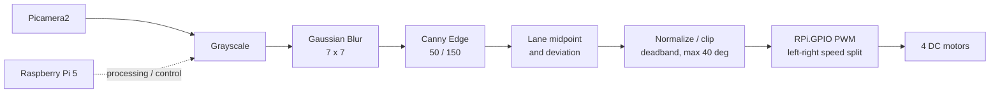
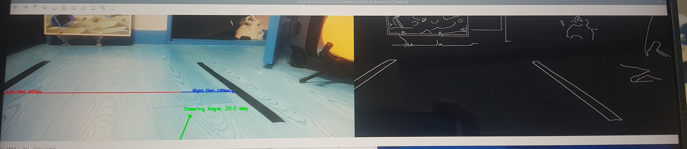
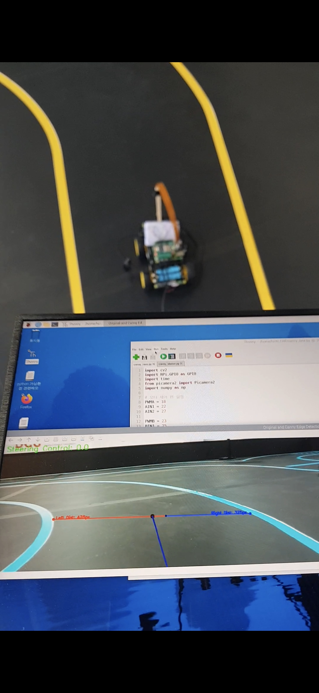
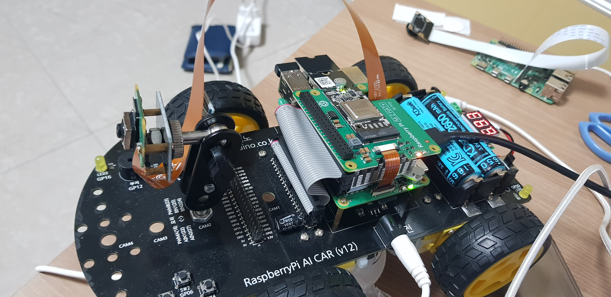

# Raspberry Pi 5 미니카 차선 인식 및 모터 제어

## 프로젝트 개요

1/10 스케일 4륜 미니카에 Raspberry Pi 5와 카메라를 탑재하고, 영상의 차선 위치를 계산해 좌우 구동 모터의 속도를 조절하는 차선 추종 시스템을 구성했다. 카메라 영상 처리와 모터 제어는 Raspberry Pi에서 수행한다.

## 시스템 구성



### 하드웨어

| 구성품 | 용도 및 확인된 정보 |
|---|---|
| 1/10 스케일 4륜 차량 플랫폼 | 주행 베이스, DC 모터 4개 |
| Raspberry Pi 5 | 영상 처리 및 GPIO 모터 제어 |
| Picamera2 카메라 | 주행 전방 영상 입력 |
| 모터 드라이버 | GPIO/PWM 명령에 따른 DC 모터 구동 |
| Hailo-8L 가속기 | YOLO segmentation 검토를 위한 환경 구성 |

### 소프트웨어

- Python
- Picamera2
- OpenCV
- NumPy
- RPi.GPIO

## 차선 인식 처리

영상 프레임에 다음 순서로 고전 컴퓨터 비전 처리를 적용했다.

1. BGR 프레임을 grayscale로 변환
2. `7 × 7` Gaussian blur로 영상 노이즈 완화
3. Canny edge detection (`low=50`, `high=150`)
4. 좌우 차선 경계의 기준점을 이용해 차선 중심 `heading_x` 계산

```text
gray = cv2.cvtColor(frame, cv2.COLOR_BGR2GRAY)
blurred = cv2.GaussianBlur(gray, (7, 7), 0)
edges = cv2.Canny(blurred, 50, 150)

heading_x = (left_point.x + right_point.x) // 2
heading_deviation = center_x - heading_x
normalized_deviation = heading_deviation / (frame_width // 4)
normalized_deviation = clip(normalized_deviation, -1, 1)
steering = normalized_deviation * max_steering_value
```

차선 좌표와 계산된 진행 방향은 디버그 화면에 오버레이해 인식 결과를 확인했다. 입력 화면과 Canny edge 영상 비교는 [차선 검출 이미지](../original/mini-car/01-lane-detection-output.jpg)에, 차량과 기준점/진행 방향 시각화는 [주행 시각화 이미지](../original/mini-car/03-lane-centerline-visualization.jpg)에 정리했다.

## 조향 및 모터 제어

계산한 차선 편차를 정규화해 최대 40° 조향 명령 범위에 매핑했다. 작은 명령 주변에서는 deadband를 두어 방향 명령의 떨림을 줄였으며, 기록된 조향 기준은 약 7°다. 조향 명령을 서보 각도로 전달하는 대신 좌우 모터 그룹의 속도를 다르게 주는 differential drive 방식으로 회전시켰다.

```text
left turn:  left motor speed decreases, right motor speed increases
right turn: left motor speed increases, right motor speed decreases
straight:   left and right motor speeds are equal
```

Raspberry Pi GPIO PWM으로 4개 DC 모터를 제어한다. 실제 duty-cycle 범위, PWM frequency, 프레임 처리 주기, 차량 속도 및 차선 추종 오차에 관한 정량 측정값은 이 기록에 포함하지 않는다.

## 구현 범위와 다음 확장

- Canny edge 기반 차선 검출 및 차선 중심 계산
- 계산된 방향 명령에 따른 좌우 모터 속도 차등 제어
- 화면 오버레이를 이용한 차선/진행 방향 확인
- Hailo-8L을 이용한 YOLO segmentation 적용은 검토하고 환경을 준비했으나, Canny 방식으로 진행해 최종 차선 추종 경로에는 통합하지 않음
- 별도 메모에 Raspberry Pi의 object inference가 약 15 FPS였다는 관찰이 기재되어 있으나, 모델·입력 크기·측정 조건과 반복 로그가 없어 성능 벤치마크로 사용하지 않음

이 미니카 프로젝트는 MATLAB Dynamic Bicycle Model 시뮬레이션과 별도의 구현이다. 두 시스템 사이의 제어 인터페이스, 동일 조건 실험, 실측 횡오차 및 지연 비교는 수행 결과에 포함되지 않는다.

## 사진


*차량 플랫폼, Raspberry Pi 계열 보드, 카메라 연결부와 구동부가 보이는 하드웨어 구성.*



*입력 영상과 edge 처리 결과를 나란히 표시한 차선 인식 화면.*



*주행 장면, 차선 기준점/방향 표시와 모터 제어 코드 화면.*



*Raspberry Pi 보드, 카메라 연결부와 가속기 검토를 위한 확장 하드웨어.*
